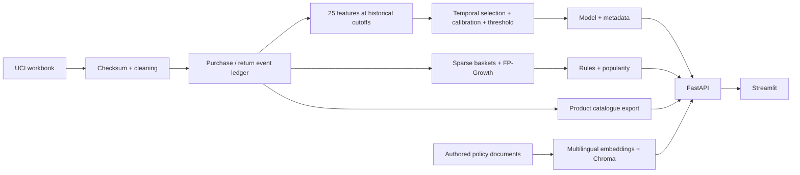

# Current architecture

Updated 2026-09-30. This supersedes earlier planned architecture descriptions.

The assistant does not train on UCI transactions. Its typed retention/recommendation tools call the same API routes, in-process via ASGI, while policy search queries Chroma and product lookup reads the catalogue exported from UCI purchases. Online retrieval embeds each question; **online does perform query embedding**, but never model training or rule mining.

## Offline contracts

| Producer | Outputs | Consumer |
|---|---|---|
| src.ingest | transactions.parquet, manifest.json, cleaning_report.json | features and rules |
| src.features | X/y, snapshots, feature_metadata, customer_features | training; historical API demo lookup |
| src.train | retention_model.joblib, retention_model_metadata.json, drift_reference, test_predictions | API lifespan; evaluation reports |
| src.rules | rules.json with selected scalar parameters; popularity.json | indexed RecommendationEngine |
| src.catalogue | product_catalogue.csv + product_catalogue_meta.json | assistant product_lookup tool |
| src.rag.index | data/chromadb + manifest; downloaded multilingual model cache | persistent RagIndex |

Canonical feature names/order: **src/contracts.py**. Config is checked against this list; metadata is validated at startup. Prediction input requires exactly those finite numeric features. There is no alternate 15- or 24-feature API.

## Chronological protocol

Training snapshots June/September 2010 → model-selection December 2010 → calibration March 2011 → calibration-choice and utility threshold June 2011 → untouched test September 2011.

All feature events precede each cutoff. Targets cover [cutoff, cutoff + 90 days), positive purchases only. Previous labels mature before the next partition. Customers recur: the problem is future behavior of known customers, not generalization to unseen identities. Selected estimator refits on train + selection-validation only; its preprocessing is frozen before calibration.

Rules mine invoices before June 2011, tune support/confidence on June–August, and evaluate September–November. Later baskets are never mined. Description identity and half-basket masking are explicit approximations.

## Request paths

- /health: process alive; /ready: required artifacts loaded with no startup errors.
- /version: model family, metrics, version and provenance from metadata.
- /feature-contract and /customers/{id}/features: canonical input and historical demo rows.
- /predict and /predict/batch: calibrated probability of returning; batch limit 500.
- /recommend: indexed antecedent matching, highest-lift deduplication, basket exclusion, popularity fallback.
- /chat: shared pre-guardrails → retrieval/provider routing → strict typed tool → grounded response/refusal.
- /metrics: durable request log (`prediction_log` table: SQLite locally, PostgreSQL in Compose), observed latencies/errors, PSI and KS when data suffice.

## Operational boundaries

MLflow experiment tracking ran locally using SQLite; registry aliases/promotion did not. DVC records outputs in dvc.lock, which is committed to git; no remote is configured. Docker Compose (`docker/compose.yml`) runs API, Streamlit, PostgreSQL and Ollama on one network, with the API's artifacts and data mounted from the host; both images were built and the stack run locally on linux/arm64 (docs/CONTAINERS.md). CI defines lint, type, test/coverage, data-quality, image-build and secret-scan jobs; the lint, type and test/coverage gates pass locally and both images build, but the secret scan and CI itself have never run, because the repository has no remote. CD is manual and opt-in, not an executed deployment.

Monitoring is single-process demonstration telemetry, not an SLO or production drift study. No automatic purge, delayed-label backfill, alert delivery or retraining trigger is implemented. No authentication or enforceable human-review workflow exists.

