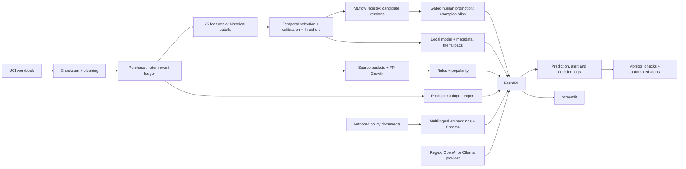

# Current architecture

Updated 2026-11-01. This supersedes earlier planned architecture descriptions.

The assistant does not train on UCI transactions. Its typed retention/recommendation tools call the same API routes, in-process via ASGI, while policy search queries Chroma and product lookup reads the catalogue exported from UCI purchases. Online retrieval embeds each question; **online does perform query embedding**, but never model training or rule mining.

## Offline contracts

| Producer | Outputs | Consumer |
|---|---|---|
| src.ingest | transactions.parquet, manifest.json, cleaning_report.json | features and rules |
| src.features | X/y, snapshots, feature_metadata, customer_features | training; historical API demo lookup |
| src.train | retention_model.joblib, retention_model_metadata.json, drift_reference, test_predictions; an MLflow run with plots and a registered candidate version | API lifespan; evaluation reports; src.registry |
| src.registry | gate reports, champion alias, approval tags | API lifespan (resolves the champion) |
| src.fairness, src.minimisation | fairness_audit.json, minimisation_audit.json and the generated tables in governance/ | governance review; promotion fairness gates |
| src.rules | rules.json with selected scalar parameters; popularity.json | indexed RecommendationEngine |
| src.catalogue | product_catalogue.csv + product_catalogue_meta.json | assistant product_lookup tool |
| src.rag.index | data/chromadb + manifest; downloaded multilingual model cache | persistent RagIndex |

Canonical feature names/order: **src/contracts.py**. Config is checked against this list; metadata is validated at startup. Prediction input requires exactly those finite numeric features. There is no alternate 15- or 24-feature API.

## Chronological protocol

Training snapshots June/September 2010 → model-selection December 2010 → calibration March 2011 → calibration-choice and utility threshold June 2011 → untouched test September 2011.

All feature events precede each cutoff. Targets cover [cutoff, cutoff + 90 days), positive purchases only. Previous labels mature before the next partition. Customers recur: the problem is future behavior of known customers, not generalization to unseen identities. Selected estimator refits on train + selection-validation only; its preprocessing is frozen before calibration.

Rules mine invoices before June 2011, tune support/confidence on June–August, and evaluate September–November. Later baskets are never mined. Description identity and half-basket masking are explicit approximations.

## Request paths

- **/health and /ready.** /health: the process is alive. /ready: the required artifacts loaded with no startup errors.
- **/version.** Model family, metrics, version and provenance from metadata, plus `model_source`: the registry champion, or the local fallback and why it was used.
- **/feature-contract and /customers/{id}/features.** The canonical input and historical demo rows.
- **/predict and /predict/batch.** Calibrated probability of returning; batch limit 500.
- **/recommend.** Indexed antecedent matching, highest-lift deduplication, basket exclusion, popularity fallback.
- **/chat.** Shared pre-guardrails → retrieval/provider routing → strict typed tool → grounded response or refusal.
- **/chat/stream.** The same path, delivered as newline-delimited JSON events.
  - With OpenAI or Ollama, a policy answer is written by the model from the cited excerpts.
  - A figure check flags figures the answer adds or leaves out, and any failure falls back to the source text.
- **/metrics.** Built from the durable request log (`prediction_log` table: SQLite locally, PostgreSQL in Compose). Every check carries its rule, and the status is the worst level. The checks:
  - error rate and `/predict` p95 latency;
  - input and prediction drift (PSI and KS);
  - data quality;
  - rule fire rate.
- **/alerts.** What the background monitor raised and resolved.
- **POST and GET /decisions.** A named reviewer approves or rejects the model's proposed action; the audit trail is kept in `decision_log`.

## Operational boundaries

- **MLflow.** Every run is tracked: parameters, metrics, data and git hashes, and the reliability and threshold plots. Each model is registered as a candidate version. The `champion` alias moves only through a gated, human promotion (`governance/PROMOTION_POLICY.md`). The API serves the champion, falling back to `artifacts/`; no version has been promoted yet.
- **DVC.** Outputs are recorded in dvc.lock, which is committed to git. No remote is configured.
- **Docker Compose** (`docker/compose.yml`). It runs the API, Streamlit, PostgreSQL and Ollama on one network, with the API's artifacts and data mounted from the host; MLflow is behind the optional `tracking` profile. The API and interface images were built and the stack run locally on linux/arm64 (docs/CONTAINERS.md).
- **CI.** Defines lint, type, test/coverage, assistant tool-choice, data-quality, image-build and secret-scan jobs. Everything that can run locally passes, but CI itself has never run, because the repository has no remote.
- **CD.** Triggers on merge to `main` once `ENABLE_CLOUD_DEPLOYMENT` is set; it has never run.
- **Weekly retraining** (`.github/workflows/retrain.yml`). It opens a pull request with metrics and gate results and never deploys; it has never run.
- **SageMaker.** The training, tuning and endpoint code and image exist and ran locally (docs/SAGEMAKER.md), not on AWS.
- **Monitoring** is single-process demonstration telemetry, not an SLO or production drift study.
  - Implemented: a background task re-evaluates every check and delivers alerts to the log, the `alert_log` table and an optional webhook (docs/MONITORING.md).
  - Not implemented: automatic purge and delayed-label backfill; the backfill design is documented.
- **Human approval and authentication.** The approval step records human decisions, but there is no authentication, so a reviewer's name is declared, not verified.

