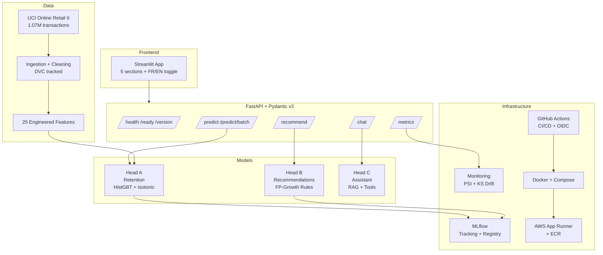

# 🍁 Boréal Marché — Customer Intelligence Platform

An end-to-end AI system that predicts customer retention, recommends products, and answers policy questions in French and English — from raw transactions to a monitored, deployed, governed platform.

> **Capstone project for Vanier College course 420-977-VA — AI Development Project.**

| | |
|---|---|
| **Live application** | `https://boreal-marche.example.com` *(placeholder — replace after deployment)* |
| **API documentation** | `https://boreal-marche.example.com/docs` |
| **MLflow dashboard** | `http://localhost:5000` (local) |
| **CI status** |  |

---

## Architecture



---

## Three Model Heads

| Head | Technique | Business Question | Primary Metric |
|---|---|---|---|
| **A — Prédiction** | HistGradientBoosting (calibrated) | Will this customer return in 90 days? | PR-AUC |
| **B — Recommandation** | FP-Growth association rules | What should we suggest next? | Hit-rate@5 |
| **C — Assistant** | RAG + tool calling (3 providers) | Answer policy questions bilingually | Tool-choice accuracy |

---

## Results

### Head A — Retention Prediction

| Model | PR-AUC | ROC-AUC | Brier | Recall@10% |
|---|---|---|---|---|
| DummyClassifier (baseline) | — | 0.500 | — | — |
| Business heuristic (recency < 60d) | ~0.60 | ~0.65 | — | — |
| LogisticRegression | — | — | — | — |
| RandomForest | — | — | — | — |
| **HistGradientBoosting** | **—** | **—** | **—** | **—** |

*Cells are populated after training. Run `python src/train.py` to fill them.*

### Head B — Recommendations

| Metric | Value |
|---|---|
| Rule count | — |
| Hit-rate@5 | — |
| Coverage | — |

### Head C — Assistant

| Provider | Tool-choice accuracy | Refusal rate (OOS) | Avg. latency |
|---|---|---|---|
| Regex (baseline) | — | — | — |
| OpenAI (gpt-4o-mini) | — | — | — |
| Ollama (llama3.1) | — | — | — |

---

## Quickstart

### Prerequisites
- Python 3.11+
- Docker & Docker Compose
- (Optional) An OpenAI API key for Head C
- (Optional) Ollama for local LLM

### Run locally

```bash
# 1. Clone
git clone https://github.com/YOUR_USERNAME/boreal-marche.git
cd boreal-marche

# 2. Create virtual environment
python -m venv .venv
source .venv/bin/activate

# 3. Install
pip install -e ".[dev]"

# 4. Download and prepare data
python src/ingest.py

# 5. Build features and train
python src/features.py
python src/train.py

# 6. Mine association rules
python src/rules.py

# 7. Build RAG index
python src/rag/index.py

# 8. Start the API
uvicorn api.main:app --reload --port 8000

# 9. Start the frontend (new terminal)
streamlit run app/streamlit_app.py
```

### Run with Docker

```bash
# Full stack (API + Streamlit + MLflow)
docker compose up --build

# With local Ollama for Head C
docker compose --profile with-ollama up --build
```

### Run tests

```bash
pytest tests/ -v --tb=short
coverage run -m pytest && coverage report --fail-under=80
```

---

## Repository Structure

```
boreal-marche/
├── api/                    # FastAPI application
│   ├── main.py             # App entrypoint + lifespan
│   ├── schemas.py          # Pydantic v2 request/response models
│   └── routers/            # Route handlers (predict, recommend, chat, monitor)
├── app/
│   └── streamlit_app.py    # Five-section Streamlit interface
├── src/                    # Core ML pipeline
│   ├── ingest.py           # Data download, validation, Parquet conversion
│   ├── features.py         # 25+ feature engineering
│   ├── train.py            # Spot-check, Optuna HPO, calibration, threshold
│   ├── rules.py            # Apriori + FP-Growth rule mining
│   ├── recommend.py        # Rule-based recommendation engine
│   └── rag/                # Head C — grounded assistant
│       ├── index.py        # Document chunking + embedding
│       ├── tools.py        # Typed Pydantic tool definitions
│       ├── providers.py    # Regex / OpenAI / Ollama backends
│       └── guardrails.py   # Refusal, similarity floor, citations
├── configs/
│   └── pipeline.yaml       # All configuration in one place
├── tests/                  # pytest suite with golden-prediction regression
├── scripts/
│   ├── simulate_traffic.py # Traffic simulation with drift injection
│   └── retrain.py          # Scheduled retraining pipeline
├── docs/corpus/            # Policy documents for Head C RAG
├── governance/             # Law 25 compliance
│   ├── GOVERNANCE_LOI25.md # Automated-decision register + data minimisation
│   ├── MODEL_CARD.md       # Model card (Mitchell et al. format)
│   ├── DATA_CARD.md        # Data provenance and bias
│   ├── decision_register.md
│   └── fairness_audit.md   # Subgroup fairness analysis
├── artifacts/              # Serialised models and rule files
├── notebooks/              # Development notebooks (EDA, tuning, evaluation)
├── Dockerfile              # Multi-stage, non-root, health-checked
├── docker-compose.yml      # API + Streamlit + MLflow + Ollama
└── .github/workflows/      # CI (lint, test, build) + CD (OIDC, deploy, retrain)
```

---

## Data Provenance

⚠️ **This project uses the [UCI Online Retail II](https://archive.ics.uci.edu/dataset/502/online+retail+ii) dataset (CC BY 4.0), a public dataset re-skinned as "Boréal Marché" for pedagogical purposes. No real Boréal Marché company or customer data exists.** See [`governance/DATA_CARD.md`](governance/DATA_CARD.md) for full provenance.

---

## Governance

This project complies with Québec's Law 25 (Loi modernisant des dispositions législatives en matière de protection des renseignements personnels). Key documents:

- [`GOVERNANCE_LOI25.md`](governance/GOVERNANCE_LOI25.md) — Automated-decision register, human-review design, data-minimisation audit
- [`MODEL_CARD.md`](governance/MODEL_CARD.md) — Model details, intended use, ethical considerations
- [`DATA_CARD.md`](governance/DATA_CARD.md) — Data source, schema, known quality issues, bias
- [`fairness_audit.md`](governance/fairness_audit.md) — Subgroup analysis with mitigations

---

## What I Would Do Next

1. **Real data.** Replace the UCI dataset with actual Boréal Marché transaction data and re-validate all models.
2. **Embedding-based recommendations.** Replace association rules with a collaborative-filtering or neural model for better coverage on long-tail products.
3. **Online learning.** Implement incremental model updates as new transactions arrive, rather than full weekly retraining.
4. **A/B testing framework.** Measure the actual business impact of retention coupons against a control group.
5. **Multi-armed bandit for thresholds.** Automatically adjust the retention threshold per customer segment based on observed coupon effectiveness.
6. **Proper RAG evaluation.** Expand the golden set to 100+ questions and implement RAGAS-style automated evaluation.
7. **Next.js frontend.** Build a production-grade frontend on Vercel (stretch goal per the assignment).

---

## Built With

- [scikit-learn](https://scikit-learn.org/) — ML pipeline
- [MLflow](https://mlflow.org/) — experiment tracking and model registry
- [Optuna](https://optuna.org/) — hyperparameter optimisation
- [FastAPI](https://fastapi.tiangolo.com/) — API framework
- [Pydantic v2](https://docs.pydantic.dev/) — data validation
- [Streamlit](https://streamlit.io/) — frontend
- [Docker](https://www.docker.com/) — containerisation
- [GitHub Actions](https://github.com/features/actions) — CI/CD

---

*Built by Eraldo Ibrushi for Vanier College course 420-977-VA.*
