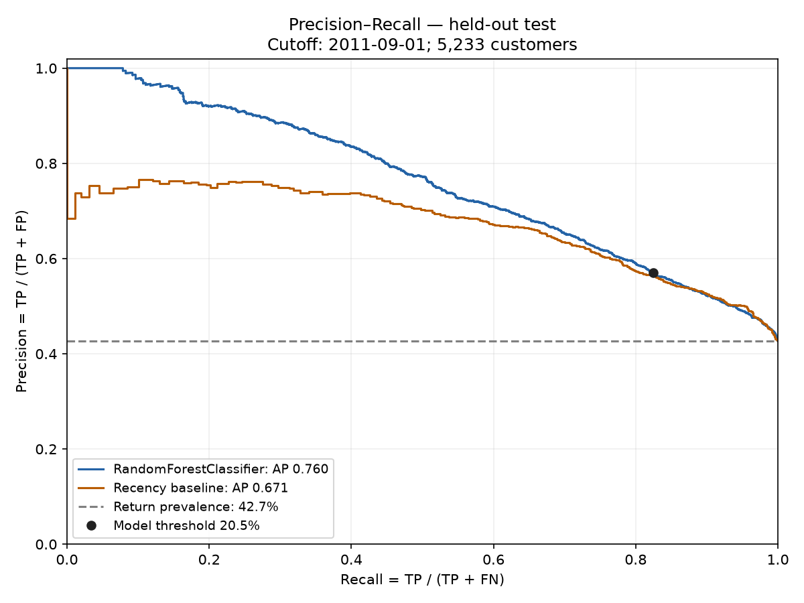
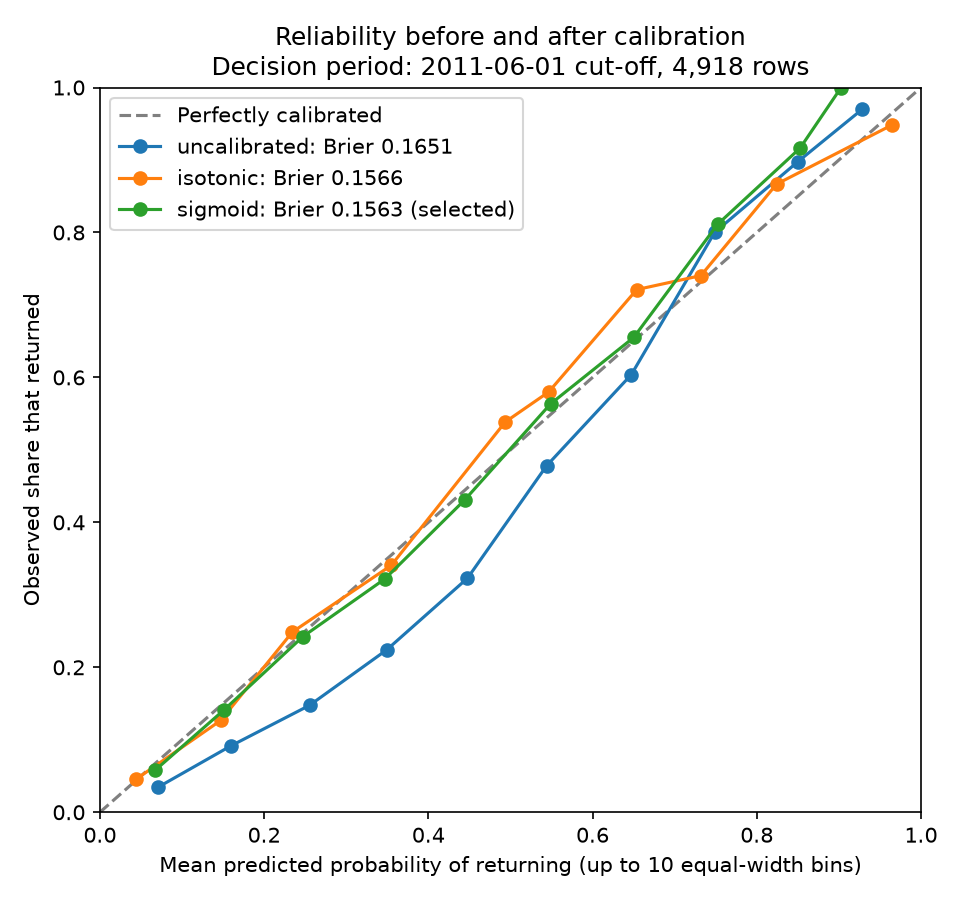

# Boréal Marché — final technical report

> Deployment update, 2026-11-06: Google Cloud hosting, public GitHub CI and merge-triggered deployment were completed after this local report. See [the current Google Cloud runbook](https://github.com/Eraldo57/boreal-marche/blob/main/docs/GOOGLE_CLOUD.md) and reports/current_run/google_cloud/ for subsequent execution evidence. Earlier pending-cloud statements below describe the dated local snapshot.

Eraldo Ibrushi · Vanier capstone · 5 November 2026

## 1. Purpose and completion boundary

Boréal Marché is an academic customer-intelligence prototype with three complementary tasks: Head A predicts a purchase within 90 days, Head B completes a partially observed shopping basket using association rules, and Head C answers policy questions or calls typed application tools. Streamlit is the user interface; FastAPI owns inference, retrieval and logging. No coupon delivery service is implemented.

The local pipeline, interface, model diagnostics and submission materials are implemented. This is not a claim of complete cloud delivery: authenticated GitHub CI, public hosting, actual AWS training/HPO and endpoint cost evidence remain outstanding. Required video, verified personal reflection and independent fresh-machine reproduction also require owner participation. The completion register maps these gaps to the original brief.

The final artifact is retention model 0.3.0, contract 2.0, with 12 serving features and sigmoid calibration. All 25 original features remain engineered and documented offline. The original 25-feature model and reports were archived before retraining. Feature removal followed June development evidence; the September test period was reused. Its updated results must not be described as a new independent holdout.

The strongest results are improved historical ranking and basket completion. The largest unresolved product questions are whether coupons produce incremental profit, whether thin-history customers are treated appropriately, whether recommendations generalise beyond popular products, and whether generated French policy answers are reliably correct.

Source: MODEL_CARD.md; docs/CAPSTONE_REQUIREMENTS_STATUS.md; reports/archive/20261105_25_feature_model/DECISION.json.

<!-- PAGEBREAK -->

## 2. Data, features and time separation

The source is UCI Online Retail II: historical UK giftware transactions, not contemporary Québec grocery data. The fictional business context does not change the source currency: monetary fields remain GBP. The workbook contains 1,067,371 rows; cleaning retains 820,645 event rows including returns, of which 802,679 are positive purchase rows. The workbook checksum and DVC pointer provide source identity; they do not establish external remote storage or fresh-machine reproduction.

Features use events strictly before each cutoff. Labels indicate a positive purchase in the next 90 days. There are six dated snapshots across five stages:

| Stage | Cutoffs | Rows | Purpose |
|---|---|---:|---|
| Train | June and September 2010 | 6,004 | Fit candidate estimators |
| Validation | December 2010 | 4,249 | Select family and tune |
| Calibration | March 2011 | 4,522 | Fit probability mappings |
| Decision | June 2011 | 4,918 | Choose mapping and utility threshold |
| Test | September 2011 | 5,233 | Evaluate the locked protocol |

The final estimator fits train plus validation, 10,253 snapshot rows. These are not 10,253 distinct people: customers can recur across snapshots. The protocol separates future labels chronologically, but does not test unseen-customer generalisation or remove seasonal/domain change.

The 12 inputs cover recency, frequency, order-value mean/spread, order-gap mean/spread, one-time status, basket size, single-line share, leading-category share, category count and morning share. Structural defaults are explicit: fewer than two gaps gives gap standard deviation zero; exactly one positive invoice gives one-time status one. Categories are weak first-description-token proxies. Contract validation rejects missing/extra keys and invalid numeric ranges.

Source: src/features.py; src/contracts.py; governance/FEATURE_INVENTORY.md; DATA_CARD.md; data/raw/online_retail_II.xlsx.dvc.

<!-- PAGEBREAK -->

## 3. Head A — ranking and uncertainty

Eight classifier families, a stratified dummy and a recency rule are compared on the validation period. The two leading tunable families receive 12 Optuna trials each. Real learning curves fit earlier 50%, 75% and 100% training rows against the same later validation period; MedianPruner stopped nine of 24 trials. Intermediate scores are measured, not fabricated pruning signals.

The selected Random Forest reports September average precision 0.7596, ROC-AUC 0.7863 and Brier 0.1940. Recency ranking, scored as 1/(1+recency_days), gives AP 0.6711 and ROC-AUC 0.7608; the dummy gives AP 0.4313. Return prevalence is 42.73%. AP is sklearn average precision, historically labelled PR-AUC here, rather than trapezoidal PR integration.

AP summarises precision at retrieved returners across score thresholds. ROC-AUC measures pairwise ranking through true-positive and false-positive rates. Both are reported; neither proves economic impact. Accuracy alone ignores ranking and depends on a chosen threshold. Predicting everyone returns would achieve 42.73% accuracy; predicting nobody returns would achieve 57.27%.

A paired bootstrap of 1,000 unique test customers gives AP interval 0.7425–0.7749 and model-minus-recency AP interval +0.0708–+0.1049. These intervals condition on the selected model and one reused historical period. They do not measure retraining uncertainty or future transfer.

Source: src/train.py; src/ranking_plots.py; scripts/evaluate_retention.py; reports/current_run/retention_diagnostics.json.

<!-- PAGEBREAK -->

## 4. Head A — calibration, utility and coupon limits

March fits probability mappings; June compares uncalibrated, isotonic and sigmoid Brier scores: 0.16506, 0.15665 and 0.15631. Sigmoid is selected. Brier is mean squared probability error, not an error percentage or a pure calibration-only measure. September Brier 0.19398 is on a later population and should not be compared with June as though the customers were identical.

With purchase probability p, assumed coupon cost C, retained margin M and missed-return cost F, offer utility is pM−C and no-offer utility is −pF. Offering is preferred when p≥C/(M+F), if M+F>0. With C=5, M=25 and F=0 the theoretical threshold is 20%. A 201-point June sweep chooses the empirical 20.5% optimum, with 20,005 assumed utility units. The Streamlit formula and curve use saved assumptions; the inspection slider does not change the deployed policy.

At 20.5%, the model selects 3,234/5,233 customers. Confusion counts: TP 1,843, FP 1,391, FN 393, TN 1,606. Recall is 82.42% versus 81.93% for an equal-count recency rule; precision is 56.99%. The binary gain is small even though overall ranking improves.

This objective credits selected purchases without modelling what would happen without a coupon. Equal coupons at 23% and 90% purchase probabilities therefore are a simplifying scenario, not an optimal treatment policy. Incremental profit requires coupon/control outcomes, offer costs/redemption data, margins and a budget-aware uplift policy.

Source: frontend/coupon.py; frontend/evaluation.py; src/train.py → utility/select_threshold; retention_metrics.json; retention_diagnostics.json.

<!-- PAGEBREAK -->

## 5. Head B — association mining and conclusions

Positive invoices become sets of canonical product descriptions. Repeated units do not repeat the item in a basket. Prefixes such as “10 colour spaceboy pen” come from the recorded description and are distinct from the Quantity field. Description-based identity can merge or fragment SKUs and needs future normalisation.

Mining uses 25,601 training baskets and 4,687 descriptions. A validation sweep chooses support 0.5% and confidence 10%; lift 1.2 and maximum combined itemset size three are fixed constraints. Support requires at least ceil(25,601×0.005)=129 baskets containing the full union. Support/confidence are selected on development baskets, not justified as universal business constants.

For A = white hanging heart t-light holder and B = red hanging heart t-light holder:

| Quantity | Calculation | Result |
|---|---|---:|
| Support | P(A and B) | 3.535% |
| Confidence | P(A and B) / P(A) | 23.11% |
| Lift | P(B given A) / P(B) | 4.699 |

Among training baskets containing A, about 23% also contain B. This is roughly 4.7 times B’s overall frequency, an association rather than a causal or personal preference claim. Multiple-consequent rules mean all products in the consequent occur jointly.

The temporal test hides approximately half the distinct products in each eligible basket and asks whether any of five suggestions recovers at least one hidden item. Across 5,884 baskets, Hit@5 is 48.67% versus 17.23% popularity, 2.82 times higher. Four hundred single-item baskets are excluded. Rule firing is 83.67%, while catalogue coverage is only 360/4,687=7.68%. These are different denominators; most catalogue products not appearing as antecedents is not equivalent to most baskets falling back.

Both algorithms produce 3,567 identical rule keys. Measured bounded mining took Apriori 1.22 s and FP-Growth 64.45 s; FP-Growth was not faster here. Sparse matrix storage is 2.71 MB versus a 119.99 MB dense equivalent. An inverted antecedent index serves rules with local-engine p95 0.222 ms; this excludes HTTP/UI latency. Unmatched baskets explicitly use popularity fallback.

Source: src/rules.py; src/recommend.py; frontend/basket.py; recommendation_metrics.json; rules_scaling.json; defence_facts.json.

<!-- PAGEBREAK -->

## 6. Head C — retrieval, routing and answer quality

The assistant chooses among policy_search, retention_score, recommend_items and product_lookup. Inputs and outputs are typed; customer/account tools use supplied identifiers and the local historical store. A customer ID is not authentication. The three interchangeable routing providers are regex, OpenAI gpt-4o-mini and Ollama llama3.2:3b.

Six authored policy documents are indexed using a multilingual MiniLM embedding model. Small titled chunks identify larger policy sections; the current index has 130 chunks and 59 sections. Three retrieved sections are supplied for model-written policy answers. Below similarity 0.25, the assistant refuses and displays bilingual fictional support contacts. From 0.25 to 0.45 it adds caution. These are retrieval heuristics, not probabilities that an answer is true. Fictional contacts do not represent an operational support service.

The 40 development questions cover 15 policy, 10 tool, eight out-of-scope and seven French cases. Routing accuracy is 97.5% regex, 95% OpenAI and 92.5% Ollama. All providers refused the eight out-of-scope questions. These figures measure tool choice, not the correctness of policy prose or every new guardrail path.

| Historical written-answer review | Correct / 18 |
|---|---:|
| OpenAI | 11 |
| Ollama | 3 |

The saved report identifies a single AI rater, without independent human validation. The development questions informed implementation changes, so those results are not a pristine holdout. Citation presence and language match do not establish factual correctness. French questions can produce different provider answers; the simple demo prompt is “Combien coûte la livraison standard ?” with language explicitly set to French.

Regex dispatch uses text patterns and can return corpus language; it is not a trained language model. OpenAI/Ollama write policy prose but do not generate retention probabilities or recommendation rules. Typed tool results and cited source text make the answer inspectable. The next evaluation should use newly authored questions and independent bilingual raters before stronger correctness claims.

Source: api/routers/chat.py; src/rag/; tests/golden/; assistant_*_metrics.json; answer_correctness.json; tests/test_passage_confidence.py.

<!-- PAGEBREAK -->

## 7. Engineering, monitoring and governance

The offline path cleans data, engineers historical snapshots, trains/calibrates a model, mines rules and builds the policy index. The online path loads trusted model/rules/index artifacts into FastAPI; Streamlit calls it over HTTP. Prediction logging supports operational and drift views. PostgreSQL and Ollama are separate local Compose services. Health, readiness, version and feature-contract endpoints distinguish a running process from loaded dependencies.

MLflow tracks trials and provenance. Registry version 2 is a candidate; champion promotion has not occurred. Promotion requires owner acknowledgement of fairness flags under the project policy. The API reports local artifact fallback when no champion is available. Metadata records hashes, versions, timestamps, source commit and dirty state; this working tree is not a clean released commit.

Monitoring includes prediction volume, latency, quality checks, feature drift and persisted local alerts. Delayed-label backfill is a documented design, not an implemented production job: wait until prediction time plus 90 days, join mature purchase outcomes, deduplicate customer/cutoff, monitor label completeness, recompute AP/ROC/Brier and subgroup recall by scoring cohort, then propose retraining through review. An alert alone does not prove performance degradation. No external alert delivery is evidenced.

The original minimisation audit justified jointly removing 13 features, including location inputs and duplicates. The current 12-feature audit finds nine individually inconclusive signals, but dropping all nine jointly loses AP by 0.0334 (95% interval 0.0206–0.0466); they remain. Offline audit attributes are separated from serving inputs.

Five strong thin-history recall disparities remain; a very small unknown-region group is inconclusive. Alternatives include subgroup thresholds, better cold-start features and constrained optimisation, each with precision, privacy and sample-size trade-offs. The current operational mitigation is universal human review and no automatic dispatch, not statistical parity.

The bilingual notice/register explain the demo. Primary CAI guidance and private-sector statute section 12.1 were checked for automated-decision transparency/review principles. This does not certify compliance. Authentication, verified review identity, enforced retention/deletion, rights handling and operational support remain prerequisites to real customer use.

Source: ARCHITECTURE.md; docs/MONITORING.md; governance/; api/lifespan.py; src/registry.py; CAI and Légis Québec links in the source register.

<!-- PAGEBREAK -->

## 8. Validation, delivery and next work

The final local checks report 421 unit tests plus seven artifact integration tests passing. Lint and formatting target the same source directories as CI; strict type checking covers src and api. The rebuilt local stack passed 16 real HTTP checks and seven Streamlit widget/API interaction checks. These do not establish visual browser compatibility, multi-user load or a remote CI run. Container platform and size evidence is recorded separately with the execution logs.

The final PowerPoint contains 15 main slides, five appendix slides and speaker notes. A deck PDF, this report and a two-page English/French executive summary accompany the source documentation. The personal reflection is a draft that the owner must verify before submission. No video, historical milestone tag or deployment result is fabricated.

The immediate remaining delivery steps are: authenticate GitHub and inspect CI/public access; provide AWS account/profile and remaining spend limit; execute bounded SageMaker training/HPO, endpoint invocation and teardown; capture costs and local/cloud crossover; deploy the API/UI with OIDC and version smoke checks; verify a separate-machine reproduction; record the required video; review and freeze a green release.

The next scientific work is a genuinely future-period holdout, coupon/control experimentation with real costs/margins, thin-history fairness mitigation and independent bilingual assistant-answer evaluation. Adding algorithms cannot substitute for evidence about these product decisions.

### Source and assistance register

Local authoritative records: artifacts/retention_model_metadata.json; reports/current_run/retention_metrics.json; retention_diagnostics.json; recommendation_metrics.json; fairness_audit.json; minimisation_audit.json; assistant_*_metrics.json; answer_correctness.json; rules_scaling.json; logs/completion_*.

Code locations: src/contracts.py and src/features.py (inputs); src/train.py and scripts/evaluate_retention.py (estimation/evaluation); frontend/coupon.py (formula); frontend/evaluation.py (plots); src/rules.py and src/recommend.py (baskets); api/routers/chat.py and src/rag/ (assistant).

Primary external sources checked 5 November 2026: UCI Online Retail II dataset, https://archive.ics.uci.edu/dataset/502/online+retail+ii ; CAI private-enterprise guidance, https://www.cai.gouv.qc.ca/protection-renseignements-personnels/information-entreprises-privees/utilisation-communication-renseignements-personnels ; statute, https://www.legisquebec.gouv.qc.ca/en/document/cs/p-39.1 . No compliance opinion is inferred from these references.

AI tools assisted code, verification, documentation and submission preparation. Earlier written-answer scoring used one AI rater. See docs/AI_USE.md for scope, corrections and limitations. The project owner is responsible for reviewing the deliverables and being able to explain the implementation; AI-assisted prose is not an independent evaluation or a completed personal reflection.
